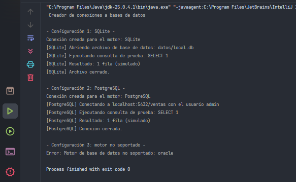

# Ejercicio 02 – Creador de conexiones a motores de base de datos

## Descripción

Un software de administración de bases de datos debe conectarse a distintos motores (SQLite o PostgreSQL) según los parámetros configurados por el usuario. Se necesita un punto de creación unificado que encapsule la construcción de cada conector.

## Objetivos

- Aplicar Factory Method para encapsular la construcción de objetos con la misma interfaz pero comportamientos distintos.
- Separar la lógica que **elige** el creador de la lógica de negocio que **usa** la conexión.
- Permitir que cada creador devuelva su conector ya configurado.

## Implementación del patrón Factory Method

| Rol en el patrón | Clase |
|---|---|
| Producto (interfaz) | `DatabaseConnection` |
| Productos concretos | `SqliteConnection`, `PostgresConnection` |
| Creador (abstracto) | `DatabaseConnectionCreator` (método de fábrica `createConnection()`) |
| Creadores concretos | `SqliteConnectionCreator`, `PostgresConnectionCreator` |
| Selección del creador | `CreatorSelector` + `DatabaseConfig` |
| Lógica de negocio | `DatabaseAdministrator` |
| Cliente | `Main` |

Cada creador concreto sobrescribe `createConnection()` y devuelve su conexión con los datos de configuración (archivo, host, puerto, base y usuario).

## Propósito de la clase

| Clase | Propósito |
|---|---|
| `DatabaseConnection` | Declara `connect()`, `executeTestQuery()`, `disconnect()` y `getEngineName()`. |
| `SqliteConnection` | Conexión simulada a un archivo local SQLite. |
| `PostgresConnection` | Conexión simulada a un servidor PostgreSQL. |
| `DatabaseConnectionCreator` | Declara el método de fábrica y `openConnection()`, que crea y abre la conexión. |
| `SqliteConnectionCreator` / `PostgresConnectionCreator` | Construyen la conexión de su motor. |
| `DatabaseConfig` | Representa los parámetros elegidos por el usuario. |
| `CreatorSelector` | Decide qué creador instanciar según la configuración. |
| `DatabaseAdministrator` | Usa la conexión (consulta de prueba) sin conocer el motor. |
| `Main` | Simula distintas configuraciones y muestra el resultado. |

## Concepto clave

La decisión de **qué creador usar** vive en `CreatorSelector`, y la decisión de **qué conexión construir** vive en cada creador concreto. La lógica de negocio (`DatabaseAdministrator`) solo trabaja con `DatabaseConnectionCreator` y `DatabaseConnection`, por lo que no cambia al agregar un motor nuevo.

## Resultado

## Conclusión

Factory Method centraliza y encapsula la creación de conectores con interfaces similares. Separar la selección de la lógica de negocio hace que el sistema sea fácil de extender (por ejemplo, con MySQL) sin tocar las clases que usan la conexión.
